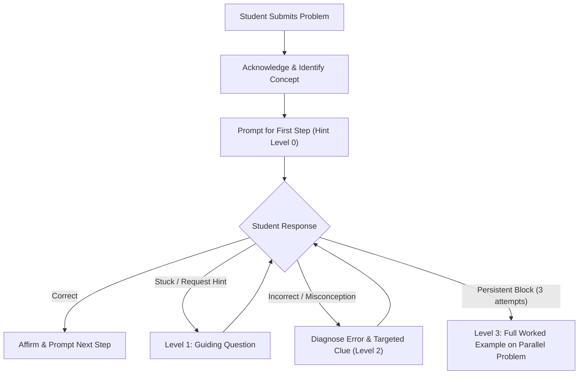
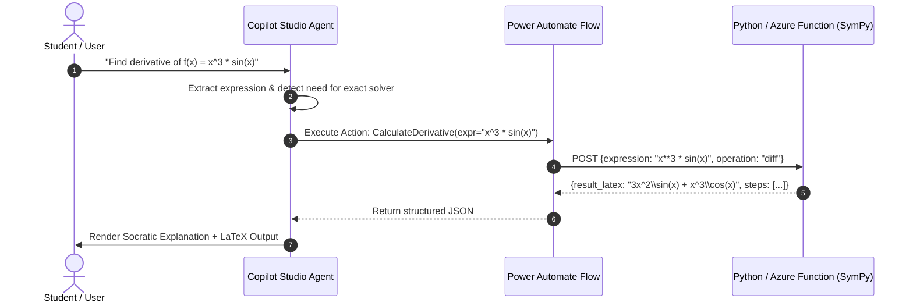

# Specialty 1: Conversational AI & Microsoft Copilot Studio Engineering

## Executive Summary
Designing a mathematics chatbot in **Microsoft Copilot for Microsoft 365 / Copilot Studio** requires specialized expertise in conversational agent architecture, dialog management, and enterprise extensibility. A mathematics chatbot must do far more than generate text; it must facilitate guided learning (Socratic tutoring), extract mathematical intents, format rich visual cards, and orchestrate external computational tools via Power Platform connectors.

---

## 1. Copilot Studio Architectural Foundations

### 1.1 The Copilot Studio Framework
Copilot Studio provides the orchestration layer for conversational agents deployed across Microsoft 365 (Teams, Microsoft 365 Chat, Outlook, and web). Key architectural components include:

- **Topics & Trigger Phrases**:
  - *System Topics*: Greeting, Escalation, Fallback, Session End.
  - *Custom Topics*: Step-by-Step Problem Solver, Concept Explanation, Formula Lookup, Practice Quiz Generator, Error Diagnosis.
  - *Trigger Optimization*: Natural language triggers using semantic similarity rather than exact keyword matches (e.g., "help me solve this quadratic", "I'm stuck on integration by parts", "check my algebra").

- **Entities & Slot Filling**:
  - Prebuilt entities (Numbers, Date/Time, Email).
  - Custom closed-list and regex entities for mathematical domains:
    - `MathBranch`: [Algebra, Geometry, Trigonometry, Calculus, Linear Algebra, Statistics, Discrete Math].
    - `GradeLevel`: [Middle School, High School, Undergraduate, Advanced].
    - `MathExpression`: Regex patterns to extract equation strings (e.g., `^[a-zA-Z0-9\^_\+\-\*/\(\)\=\.\s]+$`).

- **Variables & Context Management**:
  - Topic-level variables vs. Global/Bot variables (e.g., `Global.UserGradeLevel`, `Global.CurrentProblemState`, `Global.HintLevel`).
  - Persistent user state across conversation turns to track a multi-step proof or problem-solving journey.

---

## 2. Pedagogical Conversational Design (The Socratic Scaffold)

### 2.1 The Anti-Pattern: Direct Answer Dumping
If a student asks:
> *"Solve $2x + 7 = 15$"*

A poorly designed chatbot replies:
> *"$2x = 8 \implies x = 4$."*

This fails educationally because it encourages cognitive passivity and enables homework cheating without comprehension.

### 2.2 Socratic Scaffolding Architecture
The chatbot should implement a **4-tier hint ladder**:



1. **Level 0 (Socratic Prompt)**: *"What is the main operation keeping $x$ from being isolated on the left side?"*
2. **Level 1 (Targeted Hint)**: *"Remember that to undo addition, you subtract the same value from both sides. What should you subtract?"*
3. **Level 2 (Micro-Step)**: *"Try subtracting 7 from both sides. What is $15 - 7$?"*
4. **Level 3 (Parallel Example)**: *"Let's look at a similar problem: $3y + 4 = 19$. Subtract 4 to get $3y = 15$, then divide by 3 to get $y = 5$. Now apply that exact sequence to your equation."*

---

## 3. Microsoft 365 Extensibility & Tool Calling

### 3.1 The Deterministic Computation Gap
LLMs rely on token probabilities and will hallucinate calculations (e.g., multi-digit multiplication, matrix inverses, derivatives). A production Copilot chatbot must delegate computation to deterministic tools.



### 3.2 Power Automate Actions
- Configure a Power Automate Cloud Flow triggered by Copilot Studio.
- Accept inputs: `Expression (string)`, `OperationType (enum: solve, differentiate, integrate, simplify, factor)`.
- Connect flow to an Azure Function running Python `SymPy` or a certified math API (Wolfram Alpha / MathJS).
- Return: `ExactResult`, `DecimalResult`, `StepsArray`, `VerificationStatus`.

---

## 4. Knowledge Grounding in Microsoft 365

### 4.1 Enterprise Knowledge Sources
Grounding allows the chatbot to cite verified course material:
- **SharePoint & OneDrive**: Curated textbooks, official syllabus documents, formula sheets, grading rubrics, and past exam solutions.
- **Generative Answers Node**: Enable dynamic question answering over math curriculum PDFs with strict semantic search thresholds.
- **System Instructions**:
  ```text
  You are the M365 Mathematics Learning Companion.
  Your goal is to guide students to mathematical understanding.
  Rules:
  1. Never give the final numerical answer directly unless the student has successfully demonstrated the derivation.
  2. Always render mathematical expressions in standard LaTeX syntax: $inline$ or $$display$$.
  3. Ground your explanations strictly in the uploaded course formula sheets and curriculum guides.
  4. If an equation requires calculation, always invoke the MathEngine action rather than calculating mentally.
  ```

---

## 5. Rich UI Rendering via Adaptive Cards

### 5.1 Adaptive Cards in Microsoft Teams
To present math formulas, practice questions, and multi-step solutions cleanly in Microsoft Teams and Copilot 365 chat, use Adaptive Cards:

```json
{
  "$schema": "http://adaptivecards.io/schemas/adaptive-card.json",
  "type": "AdaptiveCard",
  "version": "1.5",
  "body": [
    {
      "type": "TextBlock",
      "text": "📐 Step-by-Step Problem Guide",
      "weight": "Bolder",
      "size": "Medium",
      "color": "Accent"
    },
    {
      "type": "TextBlock",
      "text": "Problem: Solve for x in $2x + 7 = 15$",
      "wrap": true
    },
    {
      "type": "FactSet",
      "facts": [
        { "title": "Topic", "value": "Linear Equations" },
        { "title": "Difficulty", "value": "Fundamental" },
        { "title": "Current Step", "value": "Isolating the variable term" }
      ]
    }
  ],
  "actions": [
    {
      "type": "Action.Submit",
      "title": "💡 Give Me a Hint",
      "data": { "action": "request_hint", "hint_level": 1 }
    },
    {
      "type": "Action.Submit",
      "title": "🔍 Check My Work",
      "data": { "action": "check_work" }
    }
  ]
}
```

---

## 6. Curated Learning Roadmap for this Specialty
1. **Week 1-2**: Master Copilot Studio dialogs, Topics, Entities, and Generative AI orchestration.
2. **Week 3-4**: Build Power Automate flows and Custom Actions to connect Copilot with external APIs.
3. **Week 5-6**: Implement Socratic prompting logic, error trapping, and conversation branching.
4. **Week 7-8**: Design Adaptive Cards and deploy/test in Microsoft Teams & M365 Copilot chat.
