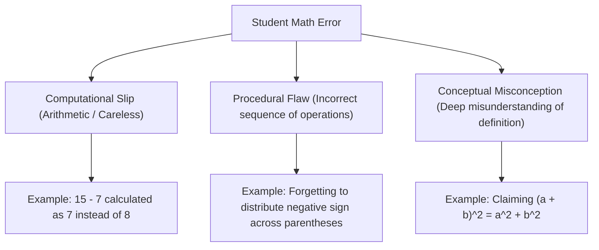

# Specialty 2: Computational Mathematics & Symbolic AI (Neuro-Symbolic Math Architecture)

## Executive Summary
Mathematics possesses a formal, deterministic, and deductive structure that is fundamentally distinct from natural language. Pure Large Language Models (LLMs) operate by predicting statistically plausible token sequences, which makes them inherently prone to calculation errors, sign errors, and invalid algebraic leaps. To design an accurate mathematics chatbot, you must master **Computational Mathematics & Symbolic AI**: the discipline of bridging neural natural language understanding with deterministic Computer Algebra Systems (CAS), program-aided reasoning, and formal mathematical verification.

---

## 1. The Neuro-Symbolic Mathematics Paradigm

### 1.1 Why LLMs Struggle with Pure Math
- **Tokenization Artifacts**: Numbers are split unpredictably across byte-pair tokens (e.g., `4567` might become `45` and `67`), making digit-level arithmetic and carry operations erratic.
- **Lack of an Internal State Register**: Multi-step calculations (e.g., long division, $4 \times 4$ matrix inversion, multi-term polynomial factorization) require an exact working memory that next-token prediction cannot reliably maintain over long sequences.
- **Hallucination of Plausible Steps**: LLMs often generate proofs or algebraic manipulations that *look* mathematically rigorous but violate formal axioms (e.g., $\sqrt{a^2 + b^2} = a + b$ or dividing by an unverified expression that could equal zero).

### 1.2 The Division of Labor
In a production mathematics chatbot, the architecture decouples understanding from computation:

| Responsibility | Neural AI (LLM / Copilot) | Symbolic AI (CAS / Python SymPy) |
| :--- | :--- | :--- |
| **User Input Parsing** | Extracts intent, reformulates word problems | Formats into formal Abstract Syntax Trees (AST) |
| **Pedagogy & Dialogue** | Socratic explanations, empathetic tone, analogies | None (pure math logic) |
| **Calculations** | *Avoids direct execution* | Evaluates exact fractions, decimals, limits, sums |
| **Algebraic Transformations** | Proposes high-level strategy (e.g., "factor the quadratic") | Computes exact roots, eigenvalues, determinants |
| **Verification & Proof** | Explains the steps | Back-substitutes roots to verify equation balance |

---

## 2. Program-Aided Reasoning: PAL & PoT

### 2.1 Program-of-Thought (PoT) Execution
Rather than calculating math in natural language, the chatbot prompts the model to generate executable Python/SymPy code:

```python
# User Question: "Find the inflection points of f(x) = 3x^5 - 5x^4 + 2"
# LLM outputs the Program-of-Thought script:
import sympy as sp

x = sp.Symbol('x', real=True)
f = 3*x**5 - 5*x**4 + 2

# First and second derivatives
f_prime = sp.diff(f, x)
f_double_prime = sp.diff(f_prime, x)

# Candidate inflection points: f''(x) = 0
candidates = sp.solve(f_double_prime, x)

# Verify concavity change around candidates
inflection_points = []
for c in candidates:
    # Check sign change of f''(x) across candidate c
    eps = sp.Rational(1, 100)
    left = f_double_prime.subs(x, c - eps)
    right = f_double_prime.subs(x, c + eps)
    if left * right < 0:
        inflection_points.append((c, f.subs(x, c)))

print("Candidates:", candidates)
print("True Inflection Points:", inflection_points)
```

By delegating the differentiation and root solving to SymPy, the chatbot achieves **100% computational accuracy**.

---

## 3. Mathematical Notation & Parsing: LaTeX & MathML

### 3.1 Input Parsing Pipeline
Students express mathematical questions in messy, non-standard formats:
- Raw plaintext: `3x^2 + 5x - 2 = 0` or `sqrt(x+1) / (x-3)`
- Informal phrasing: `three x squared plus five x minus two`
- LaTeX: `\int_{0}^{\pi} \sin^2(x) \, dx`

The chatbot pipeline must:
1. **Normalize**: Strip ambiguous characters, standardize variable names (e.g., lowercase `x`).
2. **Convert to LaTeX**: Produce standardized math representations for rendering in Microsoft Teams (`$$...$$` or MathML).
3. **Parse to AST / SymPy Expression**: Use `sympy.parsing.sympy_parser` to construct verified internal mathematical objects:
   ```python
   from sympy.parsing.sympy_parser import parse_expr, standard_transformations, implicit_multiplication_application
   
   transformations = (standard_transformations + (implicit_multiplication_application,))
   expr = parse_expr("3x^2 + 5x - 2", transformations=transformations)
   ```

---

## 4. Cognitive Error Modeling & Misconception Diagnosis

### 4.1 Taxonomy of Student Math Errors
A high-quality math chatbot does not just say *"Incorrect."* It classifies the failure mode:



### 4.2 Automated Misconception Detection
When a student proposes an intermediate step $S_{\text{student}}$, the chatbot tests for classic misconceptions:
1. **Freshman's Dream**: $(a + b)^n = a^n + b^n$?
2. **Linearity of Square Roots**: $\sqrt{x^2 + 9} = x + 3$?
3. **Cancellation across Addition**: $\frac{x + 5}{x} = 5$?
4. **Sign Distribution**: $-(3x - 4) = -3x - 4$?

When a recognized pattern is matched, the chatbot delivers a targeted conceptual correction:
> *"Notice that $\sqrt{x^2 + 9}$ cannot be simplified to $x + 3$. Try plugging in $x = 4$: $\sqrt{4^2 + 9} = \sqrt{25} = 5$, whereas $4 + 3 = 7$. Because addition is inside the square root, you cannot take the root term-by-term."*

---

## 5. Verification & Self-Consistency Checking

### 5.1 Deterministic Verification Loop
Before presenting any solution or confirming a student's answer, the chatbot runs back-substitution:
1. For an equation $f(x) = g(x)$ and proposed root $r$:
   $$\text{Check: } |f(r) - g(r)| < \epsilon$$
2. For an integral $\int f(x) \, dx = F(x)$:
   $$\text{Check: } \frac{d}{dx} F(x) \equiv f(x)$$
3. For a matrix inverse $A^{-1}$:
   $$\text{Check: } A \cdot A^{-1} = I$$

This automatic self-check guarantees that the chatbot never validates an incorrect student answer or delivers a flawed explanation.

---

## 6. Curated Learning Roadmap for this Specialty
1. **Week 1-2**: Master Python's `SymPy` library (symbolic variables, equation solving, calculus, matrices, and LaTeX printing).
2. **Week 3-4**: Implement Program-aided Language Modeling (PAL/PoT) prompts and execute sandbox verification.
3. **Week 4-5**: Study mathematical input parsing (converting natural language and fuzzy math input into formal ASTs).
4. **Week 6-8**: Build cognitive error diagnosis routines and formal verification loops for standard algebra and calculus curricula.
